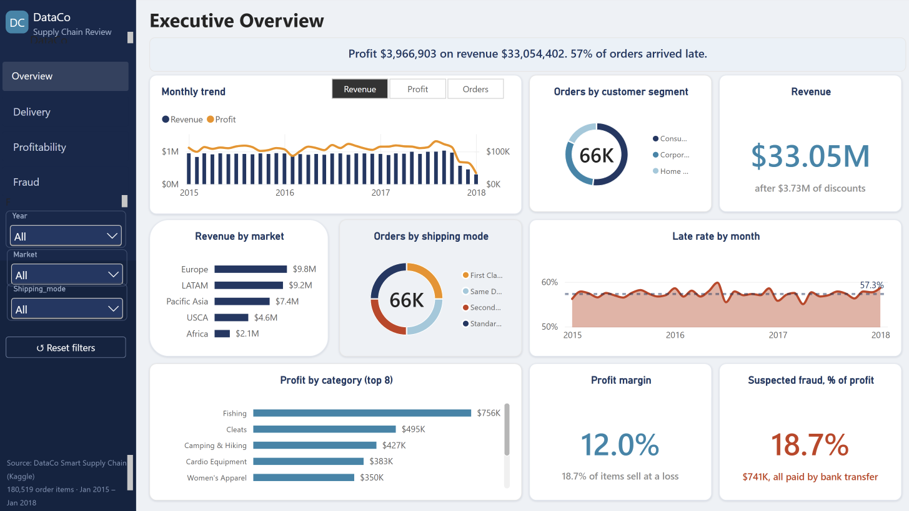
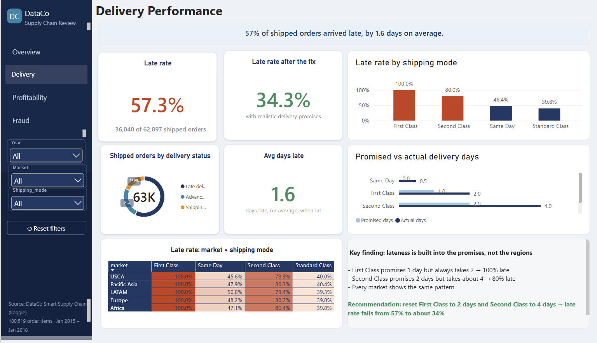
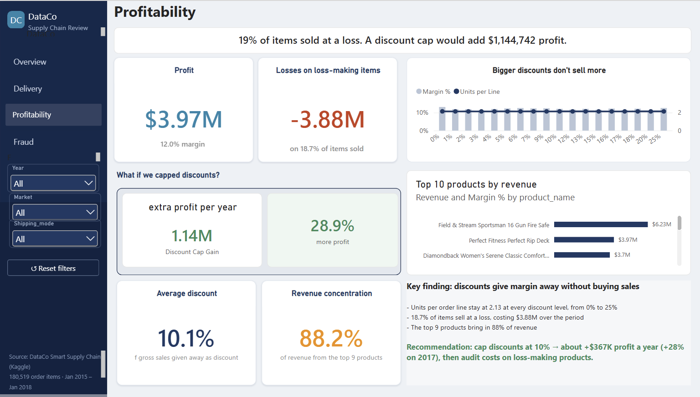
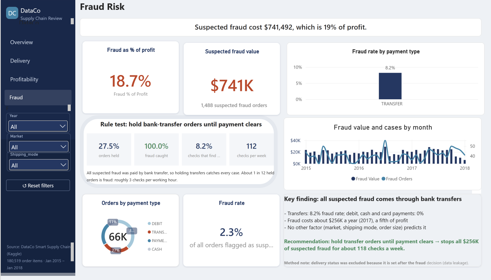
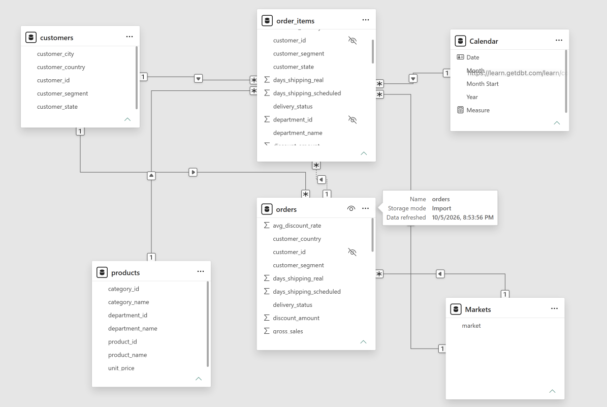

# DataCo Supply Chain Analysis

**Why are so many deliveries late, where is profit leaking, and how much does fraud cost?**
An end-to-end analysis of 180,519 order lines from a global retailer, answered with Python, SQL (DuckDB), Excel and Power BI.

📊 [Dashboard (PDF)](dashboard/dataco_dashboard.pdf) · 📑 [Executive presentation](reports/dataco_presentation.pdf) · 📝 [Executive summary](reports/executive_summary.md)



---

## Key findings

| Question | Finding | Recommendation | Impact |
|---|---|---|---|
| **Q1. Late deliveries** | **57.3%** of shipped orders arrive late. First Class is late on **100%** of orders because it promises 1 day and takes 2 | Reset promised times: First Class 2 days, Second Class 4 days | Late rate falls to **34.3%** at no cost |
| **Q2. Profitability** | **18.7%** of items sell at a loss (**−$3.88M**). Units per order line stay flat (~2.13) from 0% to 25% discount, so discounts don't drive volume | Cap discounts at 10% | **+$1.14M** profit (**+28.9%**), about $367K a year |
| **Q3. Fraud** | **$741K** of suspected fraud, equal to **18.7% of profit**. Every case was paid by bank transfer (8.2% fraud rate vs 0% for other methods) | Hold transfer orders until payment clears | Catches **100%** of suspected fraud for ~112 checks a week |

---

## Dashboard

A four-page Power BI report with a navigation panel, year/market/shipping-mode slicers, YoY indicators, a metric switcher, report-page tooltips and drill-through to category detail.

| Delivery | Profitability | Fraud |
|---|---|---|
|  |  |  |

**Interactive features:**
- **What-if parameter:** a slider tests any discount cap from 0% to 25% and shows the profit gained.
- **Rule test:** recall, precision and weekly workload for the bank-transfer hold rule.
- **Drill-through:** right-click any category to open a product-level detail page.
- **Metric switcher:** a field parameter toggles the trend between Revenue, Profit and Orders.

---

## Data model

A **galaxy schema** with two fact tables at different grains, `orders` (65,752 rows) and `order_items` (180,519 rows), sharing Calendar, Markets, Products and Customers dimensions. Over 70 DAX measures are organised into display folders (core, YoY, delivery, profitability, fraud).



Metric definitions are documented in [docs/metric_definitions.md](docs/metric_definitions.md).

---

## Approach

| Step | Notebook / file | What it does |
|---|---|---|
| 1 | [01_data_cleaning](notebooks/01_data_cleaning.ipynb) | Cleans the raw data (data types, dates, rounding errors) and logs every fix in the [data quality log](reports/data_quality_log.csv) |
| 2 | [02_sql_setup_and_exploration](notebooks/02_sql_setup_and_exploration.ipynb) | Loads the clean tables into DuckDB and explores them with SQL |
| 3 | [03_q1_late_deliveries](notebooks/03_q1_late_deliveries.ipynb) | Late rate by mode, market and region; promised vs actual days; the "fix the promise" scenario |
| 4 | [04_q2_profitability](notebooks/04_q2_profitability.ipynb) | Loss-making items, discount vs volume, discount-cap scenarios, product concentration |
| 5 | [05_q3_fraud](notebooks/05_q3_fraud.ipynb) | Fraud by payment type, market and time; designs and tests the transfer-hold rule |
| 6 | [06_validation](notebooks/06_validation.ipynb) | Cross-checks the headline numbers between Python, SQL and Power BI |
| 7 | [excel/dataco_q2.xlsx](excel/dataco_q2.xlsx) | Excel pivot analysis supporting Q2 |
| 8 | [dashboard/](dashboard/) | Power BI report (`.pbix`), custom theme and PDF export |

### Analytical decisions worth noting
- **Data leakage avoided:** `delivery_status` was excluded from the fraud analysis because every fraud order shows "Shipping canceled", a status set *after* the fraud decision.
- **Two grains kept separate:** order-level metrics (late rate, fraud) come from `orders` and item-level metrics (discounts, margin) come from `order_items`, so nothing is double-counted.
- **Scenarios are explicit:** the discount-cap gain assumes volume holds, which the flat units-per-line pattern supports but a live pilot should confirm.

---

## Tools

**Python** (pandas) · **SQL** (DuckDB) · **Excel** · **Power BI** (DAX, what-if and field parameters, drill-through, report-page tooltips) · **Git/GitHub**

---

## How to run it

1. Download the dataset from [Kaggle: DataCo Smart Supply Chain](https://www.kaggle.com/datasets/shashwatwork/dataco-smart-supply-chain-for-big-data-analysis) and put the CSV in `data/raw/`.
2. Create an environment and install the packages:
   ```bash
   python -m venv venv
   source venv/bin/activate
   pip install -r requirements.txt
   ```
3. Run the notebooks in order, `01` to `06`.
4. Open `dashboard/dataco_dashboard_v2.pbix` in Power BI Desktop (Windows), or view the [PDF export](dashboard/dataco_dashboard.pdf).

---

## Project structure

```
dataco-supply-chain-analysis/
├── dashboard/        Power BI report, theme and PDF export
├── data/             raw and clean data (not tracked; see "How to run it")
├── docs/             metric definitions
├── excel/            Excel analysis for Q2
├── images/           dashboard screenshots and data model
├── notebooks/        cleaning, SQL exploration, Q1–Q3 analysis, validation
├── reports/          executive summary, presentation, data quality log, figures
├── requirements.txt
└── README.md
```

---

## Limitations

- "Fraud" means orders labelled *suspected fraud* in the source data, not confirmed cases.
- The data ends in January 2018, which is a partial month.
- DataCo is a public dataset used for this portfolio project, not a real client.

---

**Adebayo Atkinson**, Data Analyst · [GitHub](https://github.com/GLICON)
